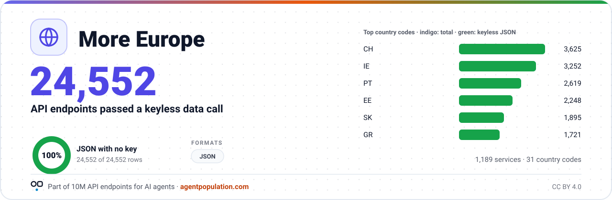
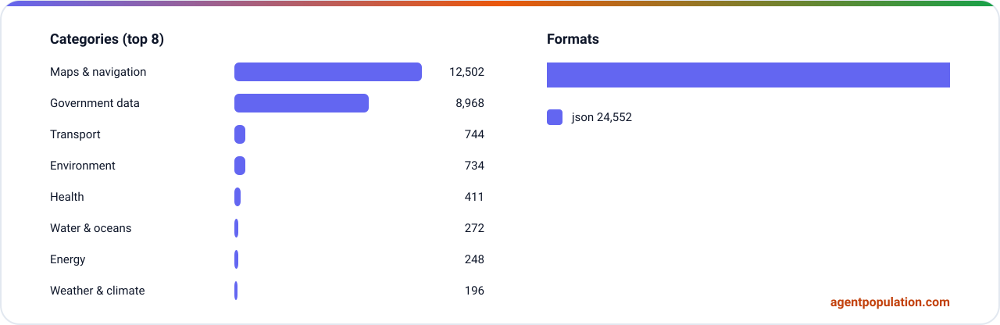

<p align="center"></p>

# 🇪🇺 More Europe API endpoints

**24,552 European API endpoints that answered a keyless GET with a data body. For agent and app builders.**

<p align="center"><a href="#files"></a> <a href="#columns-and-tags"></a> <a href="#whats-inside"></a> <a href="#whats-inside"></a> <a href="LICENSE"></a></p>

<p align="center"><a href="#whats-in-it-for-you">What's in it</a> · <a href="#for-ai-agents">For AI agents</a> · <a href="#quick-start">Quick start</a> · <a href="#test-it-yourself">Test it yourself</a> · <a href="#files">Files</a> · <a href="#licence-and-credit">Licence</a> · <a href="#part-of-10m-api-endpoints-for-ai-agents">More packs</a></p>

This repository holds a 1,000-row sample and the services list; the full list of 24,552 endpoints is one download from the [latest release](https://github.com/agentpopulation/24k-more-europe-apis-for-agents/releases/latest).

**Endpoints for building an agent or app for more of Europe.** Hosted layers of the Geneva canton, layers of Bratislava and Zagreb, and layers of Belgian, Irish, Swiss and Austrian bodies, as URLs that answered with no key on their test date.

Selection rule: rows where `country in (AD, AL, AT, BA, BE, BG, BY, CH, CY, EE, GR, HR, HU, IE, IM, JE, GG, LI, LT, LU, LV, MC, MD, ME, MK, MT, RO, RS, RU, SI, SK, SM, UA, VA, XK, PT, GI, TR)`, less the rows that a leave-out rule drops (each counted under Known limits).

8,808 of these 24,552 rows match the focus rule (below); the others are in the pack by the selection rule only, and Known limits says what they are. 22,811 rows (92.9%) are map layers on ArcGIS Online, where anyone can publish.

## In plain words

**What is an API endpoint?** An API endpoint is one web address that a program can ask for data, for example the latest reading at one weather station. A single service, such as a national weather agency, can have thousands of endpoints: one per station, city or dataset. This pack counts endpoints, not separate services.

**What does "passed a data call" mean?** On the date shown in each row, AgentPopulation sent one plain request to that address, with no password or key, and got a non-empty data body back (JSON, CSV, XML or a file): not an error page and not an empty result. Some bodies describe a dataset rather than hold its values; see Known limits. It shows the address answered with data on that day. It is not a promise that it answers today, and licences and usage limits were not reviewed.

## What's in it for you

Four ways to use this pack. Each bucket gives a count, a filter you can apply to the CSV, one example that passed, and a list of recommended starting points with the rule that picked them. Buckets overlap; a row can fit more than one.

Examples, recommended lists and the preview are drawn from rows that match this pack's focus rule, so a row that the selection rule put in this pack but that is about something else is not shown as a starting point. Counts cover the whole bucket.

<details>
<summary>The focus rule</summary>

Focus rule: `NOT title matches /(?<![a-z])(test|tests|testing|draft|drafts|copy|sample|samples|demo|untitled|scratch|temp|tmp|delete|deleteme|practice|dummy|example|training)(?![a-z])|final_final|\d{7,}/i AND (NOT url matches ///(services[0-9]*(-[a-z0-9]+)?|utility)\.arcgis\.com//i OR NOT service matches /^ArcGIS organization /i)`

</details>

### 🤖 Agent tools: Keyless JSON layers and tables an agent can call (European)

**24,552** endpoints from 1,189 services · Wrap one layer query as a get_layer_features tool: pass a where clause or a bounding box, return the matching features with a timeout.

24,519 of these are map-layer queries that asked for a few records (`resultRecordCount`); add a where clause or a geometry to ask about one place, and page through for the whole layer.

Start with: `tags has agent-ready`

Example: [Hosted/AGGLO\_AIRE\_URB](https://app2.ge.ch/tergeoservices/rest/services/Hosted/AGGLO_AIRE_URB/FeatureServer/0/query?where=1%3D1&outFields=*&resultRecordCount=10&f=json) · app2.ge.ch · passed 2026-11-16

<details>
<summary>Recommended starting points: 8 services, picked by the stated criteria inside</summary>

**Recommended starting points.** Selected by stated criteria, not a ranking of quality: Services in this pack with the most endpoints that match this bucket and are tagged `agent-ready` (no key sent in the test call, JSON body, passed a data call). Ties go to the service with more country codes, then by name. Only services with at least one bucket row that matches the focus rule are listed, and the sample comes from those rows; the counts cover the whole bucket. The sample URL is the first row by URL sort after preferring, in this order: rows that match the bucket's sample preference when it has one, rows that return values rather than describe a dataset or a service (not ERDDAP /info/ pages, OGC GetCapabilities requests, bare OWS addresses, PxWeb tables, UN SDG series lists, Statistics Canada download pointers, WorldPop listings, GTFS validation reports, untitled rows or service root addresses), and agent-ready rows. Sample preference in this bucket: `url matches //query\?/i`. Services named "ArcGIS organization" hold map layers from many owners and are added only when fewer than 5 other services match.

| Service (host) | Endpoints in bucket | In pack | Country codes in bucket | Formats in bucket | Sample URL that passed |
|---|---:|---:|---|---|---|
| app2.ge.ch | 1,144 | 1,144 | CH | json | [Hosted/AGGLO\_AIRE\_URB](https://app2.ge.ch/tergeoservices/rest/services/Hosted/AGGLO_AIRE_URB/FeatureServer/0/query?where=1%3D1&outFields=*&resultRecordCount=10&f=json) (2026-11-16) |
| Magistrát hlavného mesta SR, Bratislava (ArcGIS Online) (services8.arcgis.com) | 705 | 705 | SK | json | [ÚG\_školstva\_aktualizácia\_2022](https://services8.arcgis.com/pRlN1m0su5BYaFAS/ArcGIS/rest/services/%C3%9AG_%C5%A1kolstva_aktualiz%C3%A1cia_2022/FeatureServer/0/query?where=1%3D1&outFields=*&resultRecordCount=10&f=json) (2026-11-16) |
| Central Asia and Caucasus GeoPortal Hub Community (ArcGIS Online) (services5.arcgis.com) | 444 | 444 | RU | json | [Административно\_Территориальное\_деление…](https://services5.arcgis.com/Kri0Q7xwN5k6MG7L/ArcGIS/rest/services/%D0%90%D0%B4%D0%BC%D0%B8%D0%BD%D0%B8%D1%81%D1%82%D1%80%D0%B0%D1%82%D0%B8%D0%B2%D0%BD%D0%BE_%D0%A2%D0%B5%D1%80%D1%80%D0%B8%D1%82%D0%BE%D1%80%D0%B8%D0%B0%D0%BB%D1%8C%D0%BD%D0%BE%D0%B5_%D0%B4%D0%B5%D0%BB%D0%B5%D0%BD%D0%B8%D0%B5_%D0%A0%D0%9A/FeatureServer/0/query?where=1%3D1&outFields=*&resultRecordCount=10&f=json) (2026-11-16) |
| IOM Haiti (ArcGIS Online) (services2.arcgis.com) | 374 | 374 | CH | json | [Événement\_violent\_survenu\_entre\_Round\_3…](https://services2.arcgis.com/llfadFMmXWfR5SAz/ArcGIS/rest/services/%C3%89v%C3%A9nement_violent_survenu_entre_Round_3_et_Round_4__ACLED__2023_/FeatureServer/0/query?where=1%3D1&outFields=*&resultRecordCount=10&f=json) (2026-11-16) |
| ArcGIS Online Grada Zagreba (ArcGIS Online) (services8.arcgis.com) | 298 | 298 | HR | json | [Đorđićeva\_2022](https://services8.arcgis.com/Usi0jGQwMmBUpFjr/ArcGIS/rest/services/%C4%90or%C4%91i%C4%87eva_2022/FeatureServer/0/query?where=1%3D1&outFields=*&resultRecordCount=10&f=json) (2026-11-16) |
| Esri Portugal (ArcGIS Online) (services.arcgis.com) | 183 | 183 | PT | json | [AOI\_Arruda\_dos\_Vinhos](https://services.arcgis.com/CCZiGSEQbAxxFVh3/ArcGIS/rest/services/AOI_Arruda_dos_Vinhos/FeatureServer/0/query?where=1%3D1&outFields=*&resultRecordCount=10&f=json) (2026-11-16) |
| UAB ATAMIS (ArcGIS Online) (services2.arcgis.com) | 154 | 154 | LT | json | [ŽEMĖS\_PROCEDŪROS\_PANEVĖŽIO\_DEPAS](https://services2.arcgis.com/fZxlFJk6nhKyvdmq/ArcGIS/rest/services/%C5%BDEM%C4%96S_PROCED%C5%AAROS_PANEV%C4%96%C5%BDIO_DEPAS/FeatureServer/0/query?where=1%3D1&outFields=*&resultRecordCount=10&f=json) (2026-11-16) |
| Tallinn (ArcGIS Online) (services3.arcgis.com) | 146 | 146 | EE | json | [ühistranspordi\_peatus](https://services3.arcgis.com/FwX2qF9JecNSRnwr/ArcGIS/rest/services/%C3%BChistranspordi_peatus/FeatureServer/0/query?where=1%3D1&outFields=*&resultRecordCount=10&f=json) (2026-11-16) |

</details>

### 📱 App features: Map layers to draw in an app (European)

**24,519** endpoints from 1,188 services · Add the layers to an app map: read the layer once for its fields, then ask for the features in the visible area.

Start with: `url matches //(Feature|Map)Server//i`

Example: [Hosted/AGGLO\_AIRE\_URB](https://app2.ge.ch/tergeoservices/rest/services/Hosted/AGGLO_AIRE_URB/FeatureServer/0/query?where=1%3D1&outFields=*&resultRecordCount=10&f=json) · app2.ge.ch · passed 2026-11-16

<details>
<summary>Recommended starting points: 8 services, picked by the stated criteria inside</summary>

**Recommended starting points.** Selected by stated criteria, not a ranking of quality: Services in this pack with the most endpoints that match this bucket and passed a data call. Ties go to the service with more country codes, then by name. Only services with at least one bucket row that matches the focus rule are listed, and the sample comes from those rows; the counts cover the whole bucket. The sample URL is the first row by URL sort after preferring, in this order: rows that match the bucket's sample preference when it has one, rows that return values rather than describe a dataset or a service (not ERDDAP /info/ pages, OGC GetCapabilities requests, bare OWS addresses, PxWeb tables, UN SDG series lists, Statistics Canada download pointers, WorldPop listings, GTFS validation reports, untitled rows or service root addresses), and agent-ready rows. Services named "ArcGIS organization" hold map layers from many owners and are added only when fewer than 5 other services match.

| Service (host) | Endpoints in bucket | In pack | Country codes in bucket | Formats in bucket | Sample URL that passed |
|---|---:|---:|---|---|---|
| app2.ge.ch | 1,144 | 1,144 | CH | json | [Hosted/AGGLO\_AIRE\_URB](https://app2.ge.ch/tergeoservices/rest/services/Hosted/AGGLO_AIRE_URB/FeatureServer/0/query?where=1%3D1&outFields=*&resultRecordCount=10&f=json) (2026-11-16) |
| Magistrát hlavného mesta SR, Bratislava (ArcGIS Online) (services8.arcgis.com) | 705 | 705 | SK | json | [ÚG\_školstva\_aktualizácia\_2022](https://services8.arcgis.com/pRlN1m0su5BYaFAS/ArcGIS/rest/services/%C3%9AG_%C5%A1kolstva_aktualiz%C3%A1cia_2022/FeatureServer/0/query?where=1%3D1&outFields=*&resultRecordCount=10&f=json) (2026-11-16) |
| Central Asia and Caucasus GeoPortal Hub Community (ArcGIS Online) (services5.arcgis.com) | 444 | 444 | RU | json | [Административно\_Территориальное\_деление…](https://services5.arcgis.com/Kri0Q7xwN5k6MG7L/ArcGIS/rest/services/%D0%90%D0%B4%D0%BC%D0%B8%D0%BD%D0%B8%D1%81%D1%82%D1%80%D0%B0%D1%82%D0%B8%D0%B2%D0%BD%D0%BE_%D0%A2%D0%B5%D1%80%D1%80%D0%B8%D1%82%D0%BE%D1%80%D0%B8%D0%B0%D0%BB%D1%8C%D0%BD%D0%BE%D0%B5_%D0%B4%D0%B5%D0%BB%D0%B5%D0%BD%D0%B8%D0%B5_%D0%A0%D0%9A/FeatureServer/0/query?where=1%3D1&outFields=*&resultRecordCount=10&f=json) (2026-11-16) |
| IOM Haiti (ArcGIS Online) (services2.arcgis.com) | 374 | 374 | CH | json | [Événement\_violent\_survenu\_entre\_Round\_3…](https://services2.arcgis.com/llfadFMmXWfR5SAz/ArcGIS/rest/services/%C3%89v%C3%A9nement_violent_survenu_entre_Round_3_et_Round_4__ACLED__2023_/FeatureServer/0/query?where=1%3D1&outFields=*&resultRecordCount=10&f=json) (2026-11-16) |
| ArcGIS Online Grada Zagreba (ArcGIS Online) (services8.arcgis.com) | 298 | 298 | HR | json | [Đorđićeva\_2022](https://services8.arcgis.com/Usi0jGQwMmBUpFjr/ArcGIS/rest/services/%C4%90or%C4%91i%C4%87eva_2022/FeatureServer/0/query?where=1%3D1&outFields=*&resultRecordCount=10&f=json) (2026-11-16) |
| Esri Portugal (ArcGIS Online) (services.arcgis.com) | 183 | 183 | PT | json | [AOI\_Arruda\_dos\_Vinhos](https://services.arcgis.com/CCZiGSEQbAxxFVh3/ArcGIS/rest/services/AOI_Arruda_dos_Vinhos/FeatureServer/0/query?where=1%3D1&outFields=*&resultRecordCount=10&f=json) (2026-11-16) |
| UAB ATAMIS (ArcGIS Online) (services2.arcgis.com) | 154 | 154 | LT | json | [ŽEMĖS\_PROCEDŪROS\_PANEVĖŽIO\_DEPAS](https://services2.arcgis.com/fZxlFJk6nhKyvdmq/ArcGIS/rest/services/%C5%BDEM%C4%96S_PROCED%C5%AAROS_PANEV%C4%96%C5%BDIO_DEPAS/FeatureServer/0/query?where=1%3D1&outFields=*&resultRecordCount=10&f=json) (2026-11-16) |
| Tallinn (ArcGIS Online) (services3.arcgis.com) | 146 | 146 | EE | json | [ühistranspordi\_peatus](https://services3.arcgis.com/FwX2qF9JecNSRnwr/ArcGIS/rest/services/%C3%BChistranspordi_peatus/FeatureServer/0/query?where=1%3D1&outFields=*&resultRecordCount=10&f=json) (2026-11-16) |

</details>

### 🧠 Grounding and data pipelines: Statistics, boundaries, parcels and inventories for scheduled loads (European)

**585** endpoints from 163 services · Load the tables and layers on a schedule into your own store, so an agent can cite a dated source.

Start with: `format in (csv, xml, geojson) OR title matches /statist|census|population|boundar|parcel|zoning|district|budget|election|crash|permit|inventory|land ?use|landuse|cadast|address/i`

Example: [ADOPTEDCDP\_LandUseZoning - County Overview - RSES…](https://services6.arcgis.com/rZw4OLkXHeGknCxK/arcgis/rest/services/ADOPTEDCDP_LandUseZoning/FeatureServer/1/query?where=1%3D1&outFields=*&returnGeometry=false&resultRecordCount=5&f=json) · Meath County Council (ArcGIS Online) · passed 2026-11-16

<details>
<summary>Recommended starting points: 8 services, picked by the stated criteria inside</summary>

**Recommended starting points.** Selected by stated criteria, not a ranking of quality: Services in this pack with the most endpoints that match this bucket and passed a data call. Ties go to the service with more country codes, then by name. Only services with at least one bucket row that matches the focus rule are listed, and the sample comes from those rows; the counts cover the whole bucket. The sample URL is the first row by URL sort after preferring, in this order: rows that match the bucket's sample preference when it has one, rows that return values rather than describe a dataset or a service (not ERDDAP /info/ pages, OGC GetCapabilities requests, bare OWS addresses, PxWeb tables, UN SDG series lists, Statistics Canada download pointers, WorldPop listings, GTFS validation reports, untitled rows or service root addresses), and agent-ready rows. Services named "ArcGIS organization" hold map layers from many owners and are added only when fewer than 5 other services match.

| Service (host) | Endpoints in bucket | In pack | Country codes in bucket | Formats in bucket | Sample URL that passed |
|---|---:|---:|---|---|---|
| Meath County Council (ArcGIS Online) (services6.arcgis.com) | 46 | 96 | IE | json | [ADOPTEDCDP\_LandUseZoning - County Overv…](https://services6.arcgis.com/rZw4OLkXHeGknCxK/arcgis/rest/services/ADOPTEDCDP_LandUseZoning/FeatureServer/1/query?where=1%3D1&outFields=*&returnGeometry=false&resultRecordCount=5&f=json) (2026-11-16) |
| South Dublin County Council (ArcGIS Online) (services1.arcgis.com) | 22 | 91 | IE | json | [Appendix\_1\_Annual\_Budget\_2023\_SDCC](https://services1.arcgis.com/PxbTDTskGHCe4sv6/ArcGIS/rest/services/Appendix_1_Annual_Budget_2023_SDCC/FeatureServer/0/query?where=1%3D1&outFields=*&resultRecordCount=10&f=json) (2026-11-16) |
| Dun Laoghaire Rathdown County Council (ArcGIS Online) (services.arcgis.com) | 21 | 130 | IE | json | [Ballyogan\_Boundary](https://services.arcgis.com/41mg5wcsG0sphp5W/ArcGIS/rest/services/Ballyogan_Boundary/FeatureServer/0/query?where=1%3D1&outFields=*&resultRecordCount=10&f=json) (2026-11-16) |
| app2.ge.ch | 20 | 1,144 | CH | json | [Hosted/CAD\_PARCELLE\_MENSU](https://app2.ge.ch/tergeoservices/rest/services/Hosted/CAD_PARCELLE_MENSU/FeatureServer/0/query?where=1%3D1&outFields=*&resultRecordCount=10&f=json) (2026-11-16) |
| Central Asia and Caucasus GeoPortal Hub Community (ArcGIS Online) (services5.arcgis.com) | 10 | 444 | RU | json | [CA\_boundary](https://services5.arcgis.com/Kri0Q7xwN5k6MG7L/ArcGIS/rest/services/CA_boundary/FeatureServer/0/query?where=1%3D1&outFields=*&resultRecordCount=10&f=json) (2026-11-16) |
| Stadtmagistrat Innsbruck (ArcGIS Online) (services8.arcgis.com) | 10 | 20 | AT | json | [statistik\_03](https://services8.arcgis.com/LxSaGwss445axp1E/ArcGIS/rest/services/statistik_03/FeatureServer/0/query?where=1%3D1&outFields=*&resultRecordCount=10&f=json) (2026-11-16) |
| Rinkimų žemėlapių sistema (ArcGIS Online) (services5.arcgis.com) | 9 | 72 | LT | json | [LRS\_2020\_A\_T2\_STATISTICS](https://services5.arcgis.com/1eJSoE398Vejvs53/ArcGIS/rest/services/LRS_2020_A_T2_STATISTICS/FeatureServer/0/query?where=1%3D1&outFields=*&resultRecordCount=10&f=json) (2026-11-16) |
| Wicklow County Council (ArcGIS Online) (services.arcgis.com) | 9 | 92 | IE | json | [Bray\_Sláintecare\_Healthy\_Community\_boun…](https://services.arcgis.com/hQOfkHGHCu8mgDpG/ArcGIS/rest/services/Bray_Sl%C3%A1intecare_Healthy_Community_boundary/FeatureServer/0/query?where=1%3D1&outFields=*&resultRecordCount=10&f=json) (2026-11-16) |

</details>

### 🧪 Evals and testing: Varied responses to test tool calls and parsers

**24,552** endpoints · 1,189 services · 31 country codes · 1 format · Run your tool calls against a fixed set of URLs across formats and record which answer; last_tested is the baseline for your own re-tests.

Start with: the whole pack

Example: [Hosted/AGGLO\_AIRE\_URB](https://app2.ge.ch/tergeoservices/rest/services/Hosted/AGGLO_AIRE_URB/FeatureServer/0/query?where=1%3D1&outFields=*&resultRecordCount=10&f=json) · app2.ge.ch · passed 2026-11-16

<details>
<summary>Recommended starting points: 8 services, picked by the stated criteria inside</summary>

**Recommended starting points.** Selected by stated criteria, not a ranking of quality: Services in this pack that returned the most different formats, then the most endpoints that passed a data call, then by name: a mix of response shapes to test parsers and tool calls. Here the services returned 1 format each, so the order comes down to endpoint counts. Only services with at least one bucket row that matches the focus rule are listed, and the sample comes from those rows; the counts cover the whole bucket. The sample URL is the first row by URL sort after preferring, in this order: rows that match the bucket's sample preference when it has one, rows that return values rather than describe a dataset or a service (not ERDDAP /info/ pages, OGC GetCapabilities requests, bare OWS addresses, PxWeb tables, UN SDG series lists, Statistics Canada download pointers, WorldPop listings, GTFS validation reports, untitled rows or service root addresses), and agent-ready rows. Services named "ArcGIS organization" hold map layers from many owners and are added only when fewer than 5 other services match.

| Service (host) | Endpoints in bucket | In pack | Country codes in bucket | Formats in bucket | Sample URL that passed |
|---|---:|---:|---|---|---|
| app2.ge.ch | 1,144 | 1,144 | CH | json | [Hosted/AGGLO\_AIRE\_URB](https://app2.ge.ch/tergeoservices/rest/services/Hosted/AGGLO_AIRE_URB/FeatureServer/0/query?where=1%3D1&outFields=*&resultRecordCount=10&f=json) (2026-11-16) |
| Magistrát hlavného mesta SR, Bratislava (ArcGIS Online) (services8.arcgis.com) | 705 | 705 | SK | json | [ÚG\_školstva\_aktualizácia\_2022](https://services8.arcgis.com/pRlN1m0su5BYaFAS/ArcGIS/rest/services/%C3%9AG_%C5%A1kolstva_aktualiz%C3%A1cia_2022/FeatureServer/0/query?where=1%3D1&outFields=*&resultRecordCount=10&f=json) (2026-11-16) |
| Central Asia and Caucasus GeoPortal Hub Community (ArcGIS Online) (services5.arcgis.com) | 444 | 444 | RU | json | [Административно\_Территориальное\_деление…](https://services5.arcgis.com/Kri0Q7xwN5k6MG7L/ArcGIS/rest/services/%D0%90%D0%B4%D0%BC%D0%B8%D0%BD%D0%B8%D1%81%D1%82%D1%80%D0%B0%D1%82%D0%B8%D0%B2%D0%BD%D0%BE_%D0%A2%D0%B5%D1%80%D1%80%D0%B8%D1%82%D0%BE%D1%80%D0%B8%D0%B0%D0%BB%D1%8C%D0%BD%D0%BE%D0%B5_%D0%B4%D0%B5%D0%BB%D0%B5%D0%BD%D0%B8%D0%B5_%D0%A0%D0%9A/FeatureServer/0/query?where=1%3D1&outFields=*&resultRecordCount=10&f=json) (2026-11-16) |
| IOM Haiti (ArcGIS Online) (services2.arcgis.com) | 374 | 374 | CH | json | [Événement\_violent\_survenu\_entre\_Round\_3…](https://services2.arcgis.com/llfadFMmXWfR5SAz/ArcGIS/rest/services/%C3%89v%C3%A9nement_violent_survenu_entre_Round_3_et_Round_4__ACLED__2023_/FeatureServer/0/query?where=1%3D1&outFields=*&resultRecordCount=10&f=json) (2026-11-16) |
| ArcGIS Online Grada Zagreba (ArcGIS Online) (services8.arcgis.com) | 298 | 298 | HR | json | [Đorđićeva\_2022](https://services8.arcgis.com/Usi0jGQwMmBUpFjr/ArcGIS/rest/services/%C4%90or%C4%91i%C4%87eva_2022/FeatureServer/0/query?where=1%3D1&outFields=*&resultRecordCount=10&f=json) (2026-11-16) |
| Esri Portugal (ArcGIS Online) (services.arcgis.com) | 183 | 183 | PT | json | [AOI\_Arruda\_dos\_Vinhos](https://services.arcgis.com/CCZiGSEQbAxxFVh3/ArcGIS/rest/services/AOI_Arruda_dos_Vinhos/FeatureServer/0/query?where=1%3D1&outFields=*&resultRecordCount=10&f=json) (2026-11-16) |
| UAB ATAMIS (ArcGIS Online) (services2.arcgis.com) | 154 | 154 | LT | json | [ŽEMĖS\_PROCEDŪROS\_PANEVĖŽIO\_DEPAS](https://services2.arcgis.com/fZxlFJk6nhKyvdmq/ArcGIS/rest/services/%C5%BDEM%C4%96S_PROCED%C5%AAROS_PANEV%C4%96%C5%BDIO_DEPAS/FeatureServer/0/query?where=1%3D1&outFields=*&resultRecordCount=10&f=json) (2026-11-16) |
| Tallinn (ArcGIS Online) (services3.arcgis.com) | 146 | 146 | EE | json | [ühistranspordi\_peatus](https://services3.arcgis.com/FwX2qF9JecNSRnwr/ArcGIS/rest/services/%C3%BChistranspordi_peatus/FeatureServer/0/query?where=1%3D1&outFields=*&resultRecordCount=10&f=json) (2026-11-16) |

</details>

The same lists are in [recommended.json](recommended.json), ready for an agent to load.

## Questions an agent can answer with this pack

- Which layers does the canton of Geneva serve? Try [Hosted/AGGLO\_AIRE\_URB](https://app2.ge.ch/tergeoservices/rest/services/Hosted/AGGLO_AIRE_URB/FeatureServer/0/query?where=1%3D1&outFields=*&resultRecordCount=10&f=json) (app2.ge.ch, passed 2026-11-16).
- Which layers does the city of Bratislava publish? Try [ÚG\_školstva\_aktualizácia\_2022](https://services8.arcgis.com/pRlN1m0su5BYaFAS/ArcGIS/rest/services/%C3%9AG_%C5%A1kolstva_aktualiz%C3%A1cia_2022/FeatureServer/0/query?where=1%3D1&outFields=*&resultRecordCount=10&f=json) (Magistrát hlavného mesta SR, Bratislava (ArcGIS Online), passed 2026-11-16).
- Which layers does the city of Zagreb publish? Try [Đorđićeva\_2022](https://services8.arcgis.com/Usi0jGQwMmBUpFjr/ArcGIS/rest/services/%C4%90or%C4%91i%C4%87eva_2022/FeatureServer/0/query?where=1%3D1&outFields=*&resultRecordCount=10&f=json) (ArcGIS Online Grada Zagreba (ArcGIS Online), passed 2026-11-16).

## What "passed a data call" means

> [!NOTE]
> On the date in `last_tested` (IST), one GET to the URL, sent with no key, returned HTTP 2xx and a non-empty data body. HTML pages and empty results did not pass. The `format` column records what came back. This is a test result for that date, not a promise that the URL answers today. Licences, terms, rate limits, accuracy and freshness were not reviewed. Endpoints are URLs, not separate APIs; many share one service. This pack was tested 16–17 Nov 2026; snapshot 16 Nov 2026.

## For AI agents

Start from keyless JSON endpoints (`agent-ready`). The code below loads `recommended.json` and calls the first recommended service in the Agent tools bucket, with a timeout (`node examples/agent-start.mjs --recommended`). With no argument, `node examples/agent-start.mjs` calls the most recently tested agent-ready row of the sample; pass a `.csv` or `.csv.gz` path to use that file instead. See [examples/agent-start.mjs](examples/agent-start.mjs).

```js
// Node 18+. Loads recommended.json (the local copy, or the raw file on GitHub) and calls one keyless JSON endpoint.
import fs from 'node:fs';

const RAW = 'https://raw.githubusercontent.com/agentpopulation/24k-more-europe-apis-for-agents/main/recommended.json';
const rec = fs.existsSync('recommended.json')
  ? JSON.parse(fs.readFileSync('recommended.json', 'utf8'))
  : await (await fetch(RAW)).json();

const pick = rec.buckets.find((b) => b.id === 'agent').services[0];
try {
  const res = await fetch(pick.sample_url, {
    headers: { 'User-Agent': 'agent-example/1.0' },
    signal: AbortSignal.timeout(15000),
  });
  console.log(pick.service, res.status, res.headers.get('content-type'));
  console.log((await res.text()).slice(0, 300));
} catch (err) {
  console.log(`did not answer now; last passed ${pick.sample_last_tested} (${err.message})`);
}
```

How an agent picks an endpoint:

1. Filter to `agent-ready` and your country or topic.
2. Prefer the newest `last_tested` and the larger services.
3. Call with a timeout and check the body before you use it.

## Quick start

The examples run against the sample in `data/` out of the box (1,000 rows). Each takes an optional path to a `.csv` or `.csv.gz` file instead.

```bash
git clone https://github.com/agentpopulation/24k-more-europe-apis-for-agents.git
cd 24k-more-europe-apis-for-agents
python examples/quickstart.py
node examples/quickstart.mjs
node examples/agent-start.mjs
```

Full list: download `More_Europe_API_Endpoints_AgentPopulation_Snapshot_2026-11-16.csv.gz` (24,552 rows, 515.8 kB) from [releases/latest](https://github.com/agentpopulation/24k-more-europe-apis-for-agents/releases/latest), then gunzip it and pass its path. The scripts also read the `.csv.gz` as it is.

```bash
gunzip More_Europe_API_Endpoints_AgentPopulation_Snapshot_2026-11-16.csv.gz
python examples/quickstart.py More_Europe_API_Endpoints_AgentPopulation_Snapshot_2026-11-16.csv
node examples/quickstart.mjs More_Europe_API_Endpoints_AgentPopulation_Snapshot_2026-11-16.csv
```

### curl

Quote the URL: some contain commas.

```bash
curl -sL "https://raw.githubusercontent.com/agentpopulation/24k-more-europe-apis-for-agents/main/data/More_Europe_API_Endpoints_AgentPopulation_Sample.csv" | head -n 4
curl -s --max-time 15 "https://app2.ge.ch/tergeoservices/rest/services/Hosted/AGGLO_AIRE_URB/FeatureServer/0/query?where=1%3D1&outFields=*&resultRecordCount=10&f=json" | head -c 600
```

### Python

Standard library only: [examples/quickstart.py](examples/quickstart.py) reads the sample, or the path you pass, keeps agent-ready rows and calls the most recently tested one.

<details>
<summary>The code</summary>

```python
# Python 3, standard library only. Run from a clone of this repository:
#   python examples/quickstart.py [path]
# With no path it reads the sample in data/. Pass the full list from the latest release (.csv or .csv.gz) instead.
# Keeps agent-ready rows and calls the most recently tested one.
import csv
import gzip
import os
import re
import sys
import urllib.request

HERE = os.path.dirname(os.path.abspath(__file__))
path = sys.argv[1] if len(sys.argv) > 1 else os.path.join(HERE, "..", "data", "More_Europe_API_Endpoints_AgentPopulation_Sample.csv")
opener = gzip.open if path.endswith(".gz") else open
with opener(path, "rt", newline="", encoding="utf-8") as f:
    rows = list(csv.DictReader(f))

agent = [r for r in rows if "agent-ready" in r["tags"].split("|")]
# Newest test date first; URLs that describe a dataset or a service rather than return values go last.
DESCRIBES = re.compile(r"/erddap/info/|action-report\.json$|[?&]request=getcapabilities|/GeoArea/[^/?]+/List|getFullTableDownloadCSV|hub\.worldpop\.org", re.I)
agent.sort(key=lambda r: r["last_tested"], reverse=True)
agent.sort(key=lambda r: 1 if DESCRIBES.search(r["url"]) else 0)
print(len(rows), "rows,", len(agent), "agent-ready")
if not agent:
    sys.exit(0)

row = agent[0]
req = urllib.request.Request(row["url"], headers={"User-Agent": "agent-example/1.0"})
try:
    with urllib.request.urlopen(req, timeout=15) as res:
        body = res.read(1_000_000).decode("utf-8", "replace")
        print(res.status, res.headers.get("Content-Type"))
        print(body[:300])
except Exception as err:
    print(f"did not answer now; last passed {row['last_tested']} ({err})")
```

</details>

### JavaScript

Reads the sample as JSON because the CSV has quoted commas.

<details>
<summary>The code</summary>

```js
// Node 18+. Reads the sample as JSON (the CSV has quoted commas), local file first.
import fs from 'node:fs';

const FILE = 'data/More_Europe_API_Endpoints_AgentPopulation_Sample.json';
const rows = fs.existsSync(FILE)
  ? JSON.parse(fs.readFileSync(FILE, 'utf8'))
  : await (await fetch('https://raw.githubusercontent.com/agentpopulation/24k-more-europe-apis-for-agents/main/data/More_Europe_API_Endpoints_AgentPopulation_Sample.json')).json();

const row = rows.find((r) => r.tags.includes('agent-ready'));
const res = await fetch(row.url, { headers: { 'User-Agent': 'agent-example/1.0' }, signal: AbortSignal.timeout(15000) });
console.log(res.status, (await res.text()).slice(0, 300));
```

</details>

### Agent tools

[examples/agent-tools.json](examples/agent-tools.json) holds two tool definitions in the shape most tool-calling APIs accept (name, description, JSON Schema); rename `parameters` if yours uses another key. [examples/quickstart.mjs](examples/quickstart.mjs) implements them:

- `find_endpoints` searches the agent-ready rows of the list by words, country code (their format is json). When you load the tools of more than one pack, prefix the names (for example `more_europe_find_endpoints`) so they do not clash.
- `fetch_endpoint` calls one URL, **refuses any URL that is not in the list** and does not follow redirects. The allowlist is built from the CSV, so a URL injected into a prompt is refused.

The same two tools can sit behind an MCP server.

## Test it yourself

Re-test endpoints from the sample with the same rule: HTTP 2xx and a non-empty body that is not an HTML page. Node 18+, no packages.

```bash
node tools/test-endpoints.mjs
```

It tests the first 50 URLs and prints one line: tested, passed, did not pass. Options: a `.csv` or `.csv.gz` path (the full list from the release), `--limit 50`, `--timeout-ms 10000`, `--out results.csv`. The results file holds `url`, `status`, `passed`, `content_type`, `ms` and `checked_at`; a status of `timeout` or `error:<code>` means no HTTP answer came back. It is polite: GET only, no key sent, at most 4 requests in flight, one at a time per listed host, at least 1 second between requests to one listed host, and reading stops once 256 kB of a body is kept. Redirects are followed and may lead to another host. `results.csv` is in `.gitignore`.

## Preview

One row from each of the five largest services among rows that match the focus rule, services with rows that return values first.

| Title | Service | Country | Format | Tested | Link |
|---|---|---|---|---|---|
| Hosted/AGGLO\_AIRE\_URB | app2.ge.ch | CH | json | 2026-11-16 | [app2.ge.ch](https://app2.ge.ch/tergeoservices/rest/services/Hosted/AGGLO_AIRE_URB/FeatureServer/0/query?where=1%3D1&outFields=*&resultRecordCount=10&f=json) |
| ÚG\_školstva\_aktualizácia\_2022 | Magistrát hlavného mesta SR, Bratislava (ArcGIS Online) | SK | json | 2026-11-16 | [services8.arcgis.com](https://services8.arcgis.com/pRlN1m0su5BYaFAS/ArcGIS/rest/services/%C3%9AG_%C5%A1kolstva_aktualiz%C3%A1cia_2022/FeatureServer/0/query?where=1%3D1&outFields=*&resultRecordCount=10&f=json) |
| Административно\_Территориальное\_деление\_РК | Central Asia and Caucasus GeoPortal Hub Community (ArcGIS Online) | RU | json | 2026-11-16 | [services5.arcgis.com](https://services5.arcgis.com/Kri0Q7xwN5k6MG7L/ArcGIS/rest/services/%D0%90%D0%B4%D0%BC%D0%B8%D0%BD%D0%B8%D1%81%D1%82%D1%80%D0%B0%D1%82%D0%B8%D0%B2%D0%BD%D0%BE_%D0%A2%D0%B5%D1%80%D1%80%D0%B8%D1%82%D0%BE%D1%80%D0%B8%D0%B0%D0%BB%D1%8C%D0%BD%D0%BE%D0%B5_%D0%B4%D0%B5%D0%BB%D0%B5%D0%BD%D0%B8%D0%B5_%D0%A0%D0%9A/FeatureServer/0/query?where=1%3D1&outFields=*&resultRecordCount=10&f=json) |
| Événement\_violent\_survenu\_entre\_Round\_3\_et\_Round\_4\_\_ACLED\_\_… | IOM Haiti (ArcGIS Online) | CH | json | 2026-11-16 | [services2.arcgis.com](https://services2.arcgis.com/llfadFMmXWfR5SAz/ArcGIS/rest/services/%C3%89v%C3%A9nement_violent_survenu_entre_Round_3_et_Round_4__ACLED__2023_/FeatureServer/0/query?where=1%3D1&outFields=*&resultRecordCount=10&f=json) |
| Đorđićeva\_2022 | ArcGIS Online Grada Zagreba (ArcGIS Online) | HR | json | 2026-11-16 | [services8.arcgis.com](https://services8.arcgis.com/Usi0jGQwMmBUpFjr/ArcGIS/rest/services/%C4%90or%C4%91i%C4%87eva_2022/FeatureServer/0/query?where=1%3D1&outFields=*&resultRecordCount=10&f=json) |

Browse the 1,000-row sample: [Sample CSV](data/More_Europe_API_Endpoints_AgentPopulation_Sample.csv) · [Sample JSON](data/More_Europe_API_Endpoints_AgentPopulation_Sample.json).

## What's inside

<p align="center"></p>

<details>
<summary>Country codes: 31</summary>

| Code | Country | Endpoints | |
|---|---|---:|---|
| CH | Switzerland | 3,625 | `████████████████████` |
| IE | Ireland | 3,252 | `██████████████████` |
| PT | Portugal | 2,619 | `██████████████▌` |
| EE | Estonia | 2,248 | `████████████▍` |
| SK | Slovakia | 1,895 | `██████████▌` |
| GR | Greece | 1,721 | `█████████▌` |
| BE | Belgium | 1,343 | `███████▍` |
| LT | Lithuania | 1,330 | `███████▍` |
| TR | Turkiye | 975 | `█████▍` |
| HR | Croatia | 957 | `█████▎` |
| | other 21 codes | 4,587 | |

</details>

<details>
<summary>Categories: top 8</summary>

| Category | Endpoints | |
|---|---:|---|
| Navigation & Geo/Maps | 12,502 | `████████████████████` |
| Government & Open Data | 8,968 | `██████████████▍` |
| Transport & Mobility | 744 | `█▎` |
| Environment | 734 | `█▏` |
| Health | 411 | `▋` |
| Hydrology & Oceans | 272 | `▍` |
| Energy | 248 | `▍` |
| Weather & Climate | 196 | `▍` |

</details>

Formats: json 24,552

<details>
<summary>Largest services: top 25 of 1,189</summary>

| Service | Host | Endpoints | Keyless JSON | |
|---|---|---:|---:|---|
| app2.ge.ch | app2.ge.ch | 1,144 | 1,144 | `████████████████████` |
| ArcGIS Online layers (services9.arcgis.com, org 9P6TFiyjKisqXtKo) † | services9.arcgis.com | 742 | 742 | `█████████████` |
| Magistrát hlavného mesta SR, Bratislava (ArcGIS Online) | services8.arcgis.com | 705 | 705 | `████████████▍` |
| ArcGIS Online layers (services3.arcgis.com, org jzslazl8UKsLRsUc) † | services3.arcgis.com | 575 | 575 | `██████████` |
| ArcGIS Online layers (services.arcgis.com, org fe2zzRbhcPNuoFC4) † | services.arcgis.com | 535 | 535 | `█████████▍` |
| Central Asia and Caucasus GeoPortal Hub Community (ArcGIS Online) | services5.arcgis.com | 444 | 444 | `███████▊` |
| ArcGIS Online layers (services7.arcgis.com, org zX8NTiUjIKUVyth8) † | services7.arcgis.com | 421 | 421 | `███████▍` |
| ArcGIS Online layers (services-eu1.arcgis.com, org v5dOXTEOb7ZHdNyQ) † | services-eu1.arcgis.com | 405 | 405 | `███████▏` |
| ArcGIS Online layers (services-eu1.arcgis.com, org uaOuNze8ggz2HsSW) † | services-eu1.arcgis.com | 388 | 388 | `██████▊` |
| IOM Haiti (ArcGIS Online) | services2.arcgis.com | 374 | 374 | `██████▌` |
| ArcGIS Online layers (services.arcgis.com, org g8EzU2gNHvGpFUGY) † | services.arcgis.com | 356 | 356 | `██████▎` |
| ArcGIS Online layers (services-eu1.arcgis.com, org d0aKoUP6SrSc9Otp) † | services-eu1.arcgis.com | 302 | 302 | `█████▎` |
| ArcGIS Online Grada Zagreba (ArcGIS Online) | services8.arcgis.com | 298 | 298 | `█████▎` |
| ArcGIS Online layers (services-eu1.arcgis.com, org 3xqaqHjPjIkFyICi) † | services-eu1.arcgis.com | 254 | 254 | `████▌` |
| ArcGIS Online layers (services-eu1.arcgis.com, org 1cGVU2oTHcyk0zN5) † | services-eu1.arcgis.com | 234 | 234 | `████▏` |
| Esri Portugal (ArcGIS Online) | services.arcgis.com | 183 | 183 | `███▎` |
| ArcGIS Online layers (services-eu1.arcgis.com, org JzVauvrMa89dBJ9D) † | services-eu1.arcgis.com | 176 | 176 | `███▏` |
| ArcGIS Online layers (services6.arcgis.com, org f36cxNuTmfCJN313) † | services6.arcgis.com | 169 | 169 | `███` |
| ArcGIS Online layers (services1.arcgis.com, org hLNDTK5wuSZ71AQA) † | services1.arcgis.com | 168 | 168 | `██▉` |
| ArcGIS Online layers (services-eu1.arcgis.com, org rHAjZpbf6qHK8UCL) † | services-eu1.arcgis.com | 167 | 167 | `██▉` |
| ArcGIS Online layers (services-eu1.arcgis.com, org ODrCBoJHlKVMl3Cg) † | services-eu1.arcgis.com | 160 | 160 | `██▊` |
| ArcGIS Online layers (services.arcgis.com, org a3Toeu62bI4KLwUL) † | services.arcgis.com | 160 | 160 | `██▊` |
| ArcGIS Online layers (services6.arcgis.com, org 7pUfFainbiXCCjSD) † | services6.arcgis.com | 156 | 156 | `██▊` |
| ArcGIS Online layers (services-eu1.arcgis.com, org wsyZMONdkqqPc2aP) † | services-eu1.arcgis.com | 155 | 155 | `██▊` |
| ArcGIS Online layers (services9.arcgis.com, org S89MYXjXohkMMJly) † | services9.arcgis.com | 155 | 155 | `██▊` |

† No row of these services matches the focus rule: the selection rule put them in this pack, so they are not used as a starting point.

</details>

<details>
<summary>Rows per test date: 16–17 Nov 2026</summary>

| Date (IST) | Endpoints | |
|---|---:|---|
| 2026-11-17 | 1 | `▏` |
| 2026-11-16 | 24,551 | `████████████████████` |

</details>

## Files

| File | Rows | Size | Use |
|---|---:|---:|---|
| [data/More_Europe_API_Services_AgentPopulation.csv](data/More_Europe_API_Services_AgentPopulation.csv) | 1,189 | 77.1 kB | One row per service with its endpoint count in this pack |
| [data/More_Europe_API_Endpoints_AgentPopulation_Sample.csv](data/More_Europe_API_Endpoints_AgentPopulation_Sample.csv) | 1,000 | 299.9 kB | The sample: focus-rule rows first, each service in proportion to its share; ArcGIS Online layers count as one service |
| [data/More_Europe_API_Endpoints_AgentPopulation_Sample.json](data/More_Europe_API_Endpoints_AgentPopulation_Sample.json) | 1,000 | 482.8 kB | The same rows as JSON, tags as an array |
| [More_Europe_API_Endpoints_AgentPopulation_Snapshot_2026-11-16.csv.gz](https://github.com/agentpopulation/24k-more-europe-apis-for-agents/releases/latest) | 24,552 | 515.8 kB | The full list, gzipped CSV: a download from the latest release, checked by `SHA256SUMS.txt` |
| [tools/test-endpoints.mjs](tools/test-endpoints.mjs) | | | Re-tests endpoints from the sample or the full list |

Sample size: 1,000 rows, which is 1,000 or one third of the pack rounded down, whichever is smaller. Rows that match the focus rule come first. Each service gets rows in proportion to its share of those rows, at least one for the largest services and at most 50% of the sample while other services have rows; ArcGIS Online layers count as one service, whatever their organisation. Within a service, agent-ready rows, rows that return values and the newest test dates come first, and rows are written in turn across services. Service root addresses are placed at the end of the sample.

Full list: download `More_Europe_API_Endpoints_AgentPopulation_Snapshot_2026-11-16.csv.gz` (24,552 rows, 515.8 kB) from [releases/latest](https://github.com/agentpopulation/24k-more-europe-apis-for-agents/releases/latest), then gunzip it and pass its path. The scripts also read the `.csv.gz` as it is.

Excel users: Data > From Text/CSV, UTF-8. Files are UTF-8 without a byte-order mark and comma-separated.

## Columns and tags

<details>
<summary>Columns, types and tags</summary>

| Column | Type | Example | Meaning |
|---|---|---|---|
| url | string | [https://app2.ge.ch/tergeoservices/rest/…](https://app2.ge.ch/tergeoservices/rest/services/Hosted/AGGLO_AIRE_URB/FeatureServer/0/query?where=1%3D1&outFields=*&resultRecordCount=10&f=json) | The address that was tested |
| title | string | Hosted/AGGLO\_AIRE\_URB | Station, dataset or feed name |
| service | string | app2.ge.ch | The service the endpoint belongs to; joins to the services file together with host |
| host | string | app2.ge.ch | Host name of the address |
| country | string | CH | ISO 3166-1 alpha-2 code, or EU; empty when global or unknown |
| category | string | Navigation & Geo/Maps | Category of the endpoint |
| subcategory | string |  | Left empty from the 15 Nov 2026 snapshot; kept so the columns stay the same |
| format | string | json | What the test call returned: json, csv, geojson, xml, gtfs, zip, txt and so on |
| tags | string | `no-key\|json\|agent-ready` | Tags separated by \| |
| last_tested | date | 2026-11-16 | Date of the test call, YYYY-MM-DD (IST) |

| Tag | Rows | Meaning |
|---|---:|---|
| agent-ready | 24,552 | No key sent, JSON body, passed a data call on last_tested |
| json | 24,552 | Format of the body |
| no-key | 24,552 | No key was sent in the test call |

A machine-readable copy of this dictionary is in [datapackage.json](datapackage.json).

</details>

## Known limits

- 14.8% of rows carry country code CH; 0 rows have no code (global or unknown).
- 24,519 rows are map-layer queries with resultRecordCount set: the tested call asked for a few records; change the query to get the full layer.
- 22,811 rows are layers on ArcGIS Online, where anyone can publish: some are class projects, tests or copies. Check the owner and the fields before you rely on one. Only layers of organisations with a name of their own, whose titles do not read as a test, draft or copy, are used as starting points.
- 725 rows have a title that reads as a test, a draft, a copy or a sample; they are not used as starting points.
- The country code (31 more European codes, from AD to XK; the larger European countries have their own packs) is the code the endpoint is filed under, not the place the data covers and not always the publisher's country. Where a row had no code, the code of its ArcGIS organisation is used when that organisation lists one country only. In a sample of 14 titles read before release, 1 was about a place outside Europe. Filter by title or service if you need data about one place.
- Stations and feeds can go quiet after their test date; re-test a URL before you rely on it.
- Not in this pack: endpoints that need a key or a POST, and URLs that did not pass.
- Left out: 345 ArcGIS Survey123 layers (they can hold people's form answers).
- Left out: 6 class-exercise copies of the same few ArcGIS Online layers (Miami Beach sea level rise, high-risk areas without shelter, flooded areas, sea level rise and storm surge maps) across many organisations, many with a person's name in the title.
- Left out: 8 layers marked editable in the title (they can hold entries that people added).
- Left out: 27 ArcGIS layers that keep a form's default service name (they can hold people's form answers).
- Left out: 601 ArcGIS class or coursework layers (lab, assignment, exam, quiz, lesson, exercise, tutorial and final-project layers, copies of class layers, layers named for a person or a person's home, and layers whose name ends in a person's name or holds a student number).
- Left out: 21 ArcGIS layers that hold reports, comments, submissions or form responses sent in by the public.
- Left out: 16 ArcGIS layers that are records about named people (employee, patient, client or donor lists, home addresses, voter lists, sex offender and missing person layers).
- Left out: 13 rows that are another address of an ArcGIS layer dropped for what it holds (one of the reasons above, found under another address of the layer).
- Left out: 1 row of ArcGIS Online organisations that are class accounts (25 layers or more, at least 50% of them class or coursework layers): their other layers are students' work too.
- Left out: 59 rows of ArcGIS Online organisations that are class accounts (3 class sets or more in at least 20% of their rows, 10 class sets or more with no organisation name, or layers signed by students read by hand): their other layers are students' work too.
- Left out: 222 rows of class sets: one map layer saved under 5 or more students' initials or names in one ArcGIS Online organisation, or in 4 or more students' own organisations.
- Left out: 9,789 rows of university, college and school organisations and hosts (many of their layers are students' work).
- Left out: 32 rows whose address is already in an earlier pack of the collection.
- Left out: 8,361 rows that are another address form of an ArcGIS layer already in an earlier pack of the collection (the same rows under another query).
- Left out: 8,284 rows that are a second address form of an ArcGIS layer in this list (the same rows under another query); one address is kept per layer, the newest test first.

## Licence and credit

> [!IMPORTANT]
> This list (URLs, titles, tags and test results) is © 2026 AgentPopulation, released under [CC BY 4.0](https://creativecommons.org/licenses/by/4.0/). Credit AgentPopulation and link agentpopulation.com. The data each endpoint returns belongs to its provider and stays under that provider's terms; this licence does not cover it.

Copy-ready credit:

`More Europe API endpoints by AgentPopulation (https://agentpopulation.com), CC BY 4.0, snapshot 16 Nov 2026.`

GitHub's "Cite this repository" button reads [CITATION.cff](CITATION.cff).

<!-- agentpopulation:start -->
## Part of 10M API endpoints for AI agents

This pack is one of the 50 topic packs of [10m-open-apis-for-ai-agents](https://github.com/agentpopulation/10m-open-apis-for-ai-agents), the open collection by [AgentPopulation](https://agentpopulation.com). Target: 10 million+ open API endpoints that pass a keyless API call.

AgentPopulation's test run of 16 Nov 2026: 4,452,803 tested, 3,346,053 passed a data call. This is the European pack: 24,552 endpoints from 1,189 services, none of them in a pack read from the earlier snapshot, by address or as another address of the same map layer. Packs overlap, so an endpoint can appear in more than one.

For the latest tested endpoints, search [agentpopulation.com/apis](https://agentpopulation.com/apis). This pack is a snapshot from 16 Nov 2026.

Sibling packs that share the most URLs with this one: [59k-europe-region-arcgis-apis-for-agents](https://github.com/agentpopulation/59k-europe-region-arcgis-apis-for-agents) (5,841 shared) · [25k-arcgis-server-apis-for-agents](https://github.com/agentpopulation/25k-arcgis-server-apis-for-agents) (1,708 shared) · [160k-county-and-city-gis-apis-for-agents](https://github.com/agentpopulation/160k-county-and-city-gis-apis-for-agents) (1,134 shared) · [47k-public-agency-gis-apis-for-agents](https://github.com/agentpopulation/47k-public-agency-gis-apis-for-agents) (204 shared). The rest are listed in [10m-open-apis-for-ai-agents](https://github.com/agentpopulation/10m-open-apis-for-ai-agents).

Questions, pack requests, reports of endpoints that stopped answering and requests to remove a row go to [Discussions](https://github.com/agentpopulation/10m-open-apis-for-ai-agents/discussions), or to [@agentpopulation](https://x.com/agentpopulation) on X. The packs are a work in progress and corrections are welcome.

Spotted a wrong row or a dead URL? Tell us on X: [@agentpopulation](https://x.com/agentpopulation).

If this pack saved you time, a star helps others find it.

---

Compiled by [AgentPopulation](https://agentpopulation.com) with [AP Desk](https://github.com/agentpopulation/apdesk) · [10m-open-apis-for-ai-agents](https://github.com/agentpopulation/10m-open-apis-for-ai-agents)

<!-- agentpopulation:end -->
